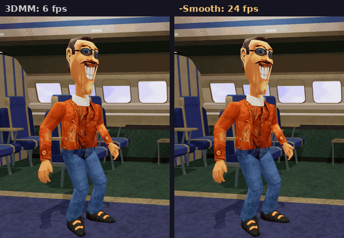

# McZee's Cut

_Your 3D Movie Maker movies, exported to video and remastered: smooth motion, real stereo 3D, CRT looks and 5.1 sound._



<sub>Gustave, one of 3DMM's own actors, in the rebuilt airplane cabin from the [set explorer](#try-the-3d-set-explorer). Every fourth frame on the right is exactly 3DMM's. The renderer's `-Smooth` uses the same blending.</sub>

McZee's Cut turns `.3mm` movies into MP4s you can watch anywhere, using
3D Movie Maker's real engine. It plays each movie headlessly and faster than
real time, so the timing, transitions, text and sound come out the way 3DMM
played them. Then it goes further than 3DMM could:

- **Smooth motion.** 3DMM animates at 6 frames a second. `-Smooth` blends
  every actor's motion between those frames and exports at 24.
- **Stereo 3D.** Side-by-side 3D for VR headsets and 3D TVs, red/cyan
  anaglyph, or plain 2D. Actors are rendered twice for real. The
  pre-rendered sets are reprojected from their depth maps.
- **CRT looks.** A 4K version that looks like a mid-90s monitor, a
  Trinitron or a TV, with an HDR option.
- **Sound.** 5.1 Dolby Digital with dialogue in the center, plus stereo.
  Loudness is leveled so every movie plays at a similar volume, and music
  ducks under speech.
- **Period-correct AVI.** A small Cinepak `.avi` that plays on Windows 95
  and 98 with nothing extra installed.
- **Whole archives at once.** Point it at a folder of movies and it
  converts everything, writes a report, and picks up where it left off if
  interrupted.

## Try the 3D set explorer

Ahead of a VR player, 3DMM's sets are being rebuilt as real 3D models. The
first one, the airplane cabin, is in a test explorer in your browser:
**[open the explorer](https://claude.ai/artifact/VJHCRE9hk4drqAkeEcy79R)**.

- Fly around the cabin, or jump to any of the 9 original 3DMM camera angles.
- Fade between the rebuilt set and the original 1995 picture to compare
  them.
- Drop in any of 3DMM's 45 actors. Choose an action and a costume, scrub
  through the frames, and play it at 3DMM's 6 fps or smoothed to 24 fps.

It works with a mouse and keyboard (WASD to move, drag to look) or on a
phone. How the sets are rebuilt is in
[`tools/sets/README.md`](tools/sets/README.md).

## Export your movies

These steps are for Windows 10 or 11.

1. Download the `3dmm-render` package from the latest successful build on
   the [Actions tab](../../actions) and unzip it. (GitHub asks you to sign
   in to download build files.) The package includes the renderer, 3D Movie
   Maker's content and the scripts below.
2. Install ffmpeg: `winget install Gyan.FFmpeg`
3. Fetch the music tools, FluidSynth and a General MIDI SoundFont:

   ```powershell
   powershell -ExecutionPolicy Bypass -File get-tools.ps1
   ```

4. Convert a folder of movies:

   ```powershell
   powershell -ExecutionPolicy Bypass -File render-folder.ps1 `
       -InputDir D:\3mm-archive -OutputDir D:\3mm-videos -Smooth
   ```

The output folder mirrors the input folder. Each movie gets
`Movie.2d.mp4` plus whatever else you asked for, and `report.csv` lists
every movie and how it went. Movies that need content you don't have,
such as the Nickelodeon pack, are marked `missing-content` along with the
packs they need. Run the script again and it skips anything already up to
date.

### Recipes

| You want | Add |
|---|---|
| The best-looking 2D video | `-Smooth` |
| 3D for a VR headset or 3D TV, plus anaglyph and 2D | `-Smooth -Stereo` |
| Only the side-by-side 3D | `-Smooth -Stereo -Formats sbs` |
| The 90s monitor look, in 4K | `-Smooth -CRT` |
| A 4K HDR CRT for an OLED | `-Smooth -CRT -CrtPreset hdr` |
| A file for a real Windows 98 PC | `-Avi` |
| The movie's own voice clips and music, as files | `-ExtractSounds` |
| The movie exactly as 3DMM played it, with 6 fps motion and the raw sound mix | `-AudioLevel original` (and leave out `-Smooth`) |

## Options

All options belong to `render-folder.ps1`. Only `-InputDir` and
`-OutputDir` are required.

### Picture

| Option | Default | What it does |
|---|---|---|
| `-Smooth` | off | Blend actor motion between 3DMM's 6 fps frames and export at 24 fps ([details](#smooth-motion)) |
| `-Stereo` | off | Render in 3D. Writes side-by-side, anaglyph and 2D unless `-Formats` says otherwise |
| `-Depth` | 2.5 | With `-Stereo`: how far behind the screen the scene can go, as % of picture width |
| `-Formats` | `2d` (`sbs,anaglyph,2d` with `-Stereo`) | Any of `sbs`, `anaglyph`, `2d`, `crt`, `avi` |
| `-Scale` | 2 | Nearest-neighbor upscale of the 544×306 picture. 2 gives 1088×612 per eye |
| `-CRT` | off | Also write `.crt.mp4`, a 4K picture with CRT effects |
| `-CrtPreset` | `pc` | `pc` (mid-90s monitor), `trinitron`, `tv` or `hdr` (10-bit HDR10) |
| `-CrtMask`, `-CrtScanlines`, `-CrtGlow`, `-CrtCurvature` | per preset | Override one part of the preset |
| `-CrtChroma` | 420 | `444` keeps phosphor colors crisp, but fewer players handle it |
| `-Avi` | off | Also write a Cinepak `.avi` at the original 544×306 for Windows 95/98 |

### Sound

| Option | Default | What it does |
|---|---|---|
| `-Channels` | `both` | `both` gives 5.1 Dolby Digital (dialogue in the center) plus stereo AAC. Or just `stereo` or `5.1` |
| `-AudioLevel` | `auto` | `auto` levels the mix: speech and effects keep their balance, music sits under dialogue and ducks when someone talks, and the movie is normalized to -16 LUFS. `original` keeps the raw mix |
| `-SoundFont` | GeneralUser GS | The MIDI instruments: any `.sf2`, `.sf3` or `.dls`, or `windows` for the Windows GS Wavetable Synth |
| `-MidiGain` | 0.6 | MIDI synth gain, before leveling |
| `-ExtractSounds` | off | Also write `.sounds.zip` with every sound imported or recorded into the movie, in order of use, plus a CSV of when each plays |
| `-IncludeLibrarySounds` | off | With `-ExtractSounds`, also include the 3DMM library sounds the movie uses |

### Playback

| Option | Default | What it does |
|---|---|---|
| `-ClickPause` | 3 | Seconds to hold a "wait for mouse click" pause |
| `-EndHold` | 3 | Seconds to hold the last frame, which 3DMM leaves on screen |
| `-Fonts` | none | A folder of extra fonts for text boxes, used only for rendering and never installed. Missing fonts fall back to the Windows system font, as in the 90s, and are listed in the report |

### Housekeeping

| Option | Default | What it does |
|---|---|---|
| `-Root` | the package folder | The folder containing `3D Movie Maker`, to use another install's content |
| `-Renderer`, `-FluidSynth` | found automatically | Paths to `3dmm-render.exe` and FluidSynth |
| `-TimeoutMinutes` | 30 | Give up on a movie that takes longer than this |
| `-KeepFrames` | off | Keep the raw frames and logs |
| `-Force` | off | Redo movies that are already up to date |

## Smooth motion

3D Movie Maker moves everything at 6 frames a second. With `-Smooth`, the
renderer draws three in-between frames for every step, and the video plays
at 24 fps.

- Every actor part's position, rotation and scale is blended. So is the
  stretch in squash-and-stretch poses. Every fourth frame is still exactly
  3DMM's own frame.
- When a part changes model, such as a new hand shape or mouth, the change
  happens halfway between frames.
- A part that turns more than about 115° in one step snaps instead of
  spinning through the turn.
- Steps where anything besides actor poses changes are left exactly as they
  were. That includes a camera cut, a text box, a costume change and an
  actor entering. So are poses the movie holds for longer than one step.
- Sound timing doesn't change. `render.log` counts the steps it blended and
  the steps it left alone.

## Running the renderer directly

`render-folder.ps1` is the easy way. For your own pipeline, the renderer
writes frames, exact timings and the extracted sounds to a folder, and
`encode-movie.ps1 -RenderDir <dir> -OutBase <name>` turns that folder into
videos.

```
3dmm-render <movie.3mm> <outdir> [options]
```

| Flag | What it does |
|---|---|
| `--smooth` | Add the 24 fps in-between frames |
| `--stereo` | Render left and right eyes, plus the 2D view |
| `--depth <pct>` | How far behind the screen the scene can go (default 2.5) |
| `--pop <pct>` | How far in front of the screen things can come (default 1.5) |
| `--root <dir>` | The folder containing `3D Movie Maker` |
| `--fonts <dir>` | Extra fonts for text boxes |
| `--click-pause <sec>` | Length of "wait for mouse click" pauses |
| `--end-hold <sec>` | How long to hold the last frame |
| `--max-frames <n>` | Stop after n frames, for quick tests |
| `--debug` | Also write depth maps and depth stats |

The full details are in [`tools/render/README.md`](tools/render/README.md):
the output files, exit codes, the sound mix, the CRT presets and how the
renderer stays faithful to 3DMM.

### Rendering in GitHub Actions

Every push builds and packages the renderer. If you put movies in
`test-movies/`, CI also renders quick previews of them. To get full-length
videos of particular movies, list them in `ci-render-requests.txt`, one file
name per line. Lines starting with `-` are options for all of them, such as
`-Smooth`. The results are pushed to the `ci-results` branch. On a public
fork, that branch is public too, so only add movies whose authors are happy
for them to be published.

## Building

You need CMake 3.23 and Visual Studio 2022. Only 32-bit x86 builds work for
now.

```console
$ cmake --preset x86:msvc:relwithdebinfo
$ cmake --build build
```

This builds `3dmovie.exe` (3D Movie Maker itself) and `3dmm-render.exe`.
[VCVars](https://github.com/bruxisma/VCVars) for PowerShell is a quick way
to set up the x86 compiler environment:
`pushvc (invoke-vcvars -TargetArch x86 -HostArch AMD64)`.

`SITOBREN.EXE` doesn't build, because it needs the SoftImage SDK, which
isn't included.

## Where this came from

McZee's Cut is a fork of [3DMMForever](https://github.com/foone/3DMMForever),
the community effort to keep 3D Movie Maker building and running on modern
systems. 3DMMForever exists because Microsoft
[released 3DMM's source code](https://github.com/microsoft/Microsoft-3D-Movie-Maker)
under the [MIT license](LICENSE) in May 2022.

Released in 1995, 3D Movie Maker let kids make animated movies from its 3D
sets, actors, sounds and music. It was hosted by McZee, who would surely
approve of this cut.

**McZee's Cut is not affiliated with or endorsed by Microsoft.** 3D Movie
Maker, McZee and the program's content belong to Microsoft.

## Legal stuff

The following sections have been carried over from the original 3D Movie Maker [GitHub repository](https://github.com/microsoft/Microsoft-3D-Movie-Maker) released by Microsoft in May 2022.

### Code cleanup

This code was restored from the Microsoft corporate archives and cleared for release.

- Developer names and aliases were removed, with the exception of current employees who worked on the
  original release who consented to keeping their names in place
- The archive consisted of several CDs, some of which were for alternate builds or products, and
  have been excluded
- The code does not build with today's engineering tools, and is released as-is.

### Trademarks

This project may contain trademarks or logos for projects, products, or services. Authorized use of Microsoft
trademarks or logos is subject to and must follow
[Microsoft's Trademark & Brand Guidelines](https://www.microsoft.com/en-us/legal/intellectualproperty/trademarks/usage/general).
Use of Microsoft trademarks or logos in modified versions of this project must not cause confusion or imply Microsoft sponsorship.
Any use of third-party trademarks or logos are subject to those third-party's policies.

This repo includes a build from 1995 of BRender from Argonaut software. Approval to open source BRender as MIT was given in an email from Jez San, former CEO of Argonaut. Other versions of BRender exist at https://github.com/foone/BRender-v1.3.2 and https://github.com/foone/BRender-1997 Thanks to Jez and the whole BRender team for their hard work on this amazing engine. A full historical list of BRender contributors is available at https://github.com/foone/BRender-v1.3.2/blob/main/README.md

This repo does NOT include the SoftImage SDK "./DKIT" from 1992.

Jez also offered this interesting BRender anecdote in an email:

```
When Sam Littlewood designed BRender, he didn’t write the code. And then document it.
The way most things were built at the time.
First, he wrote the manual.  The full documentation
That served as the spec.  Then the coding started.
```
